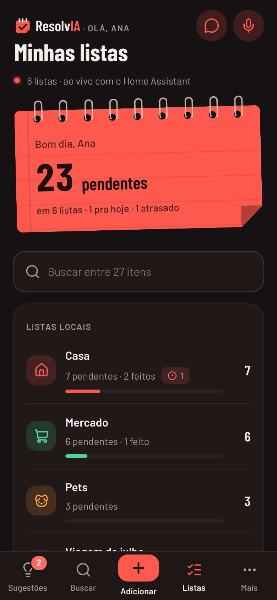
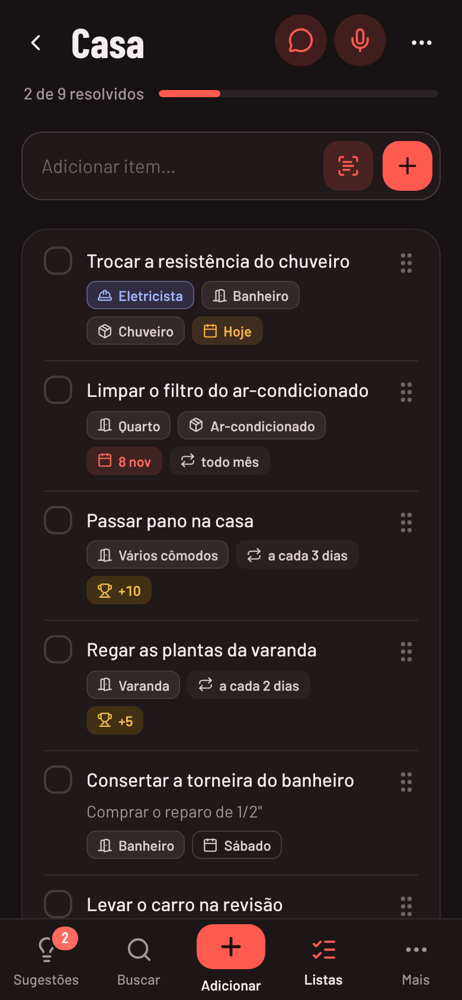
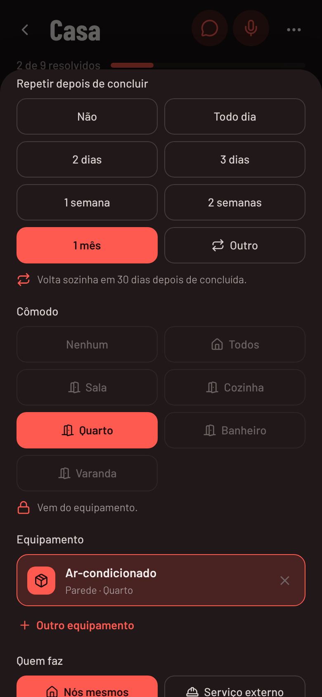
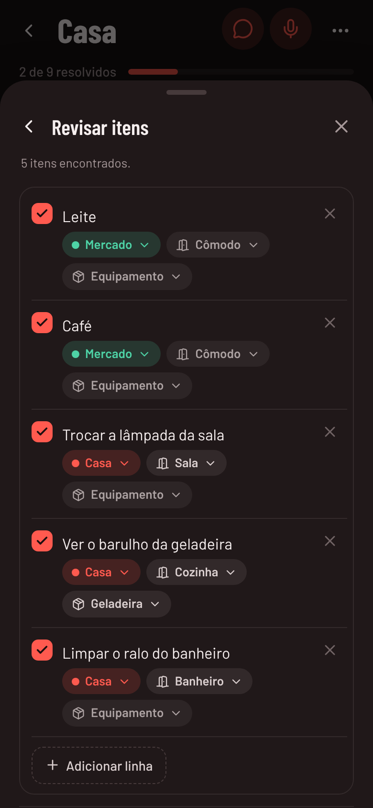

# ResolvIA para Home Assistant


Um App do Home Assistant que mostra suas **listas de tarefas nativas** (`todo.*`) num visual bem mais caprichado, traz **tarefas que voltam sozinhas** X dias depois de concluídas, liga as tarefas aos **cômodos e equipamentos** da casa e **lê itens de mensagens, fotos e fala** com IA.

<p align="center">
  
  
  
  
</p>

[](https://my.home-assistant.io/redirect/supervisor_add_addon_repository/?repository_url=https%3A%2F%2Fgithub.com%2Fdiegozapella63%2Fresolvia-ha)

## Instalação

1. Toque no botão acima. Se preferir, no Home Assistant abra **Configurações → Aplicativos → Loja de aplicativos**, toque no menu **⋮ → Repositórios** e cole:
   ```
   https://github.com/diegozapella63/resolvia-ha
   ```
2. Procure **ResolvIA** na loja, toque em **Instalar** e depois em **Iniciar**.
3. Ative **Mostrar na barra lateral**.

A primeira instalação leva alguns minutos, porque o app é montado no próprio Home Assistant.

## O que tem

- **Listas** com um "caderno" (pendentes, para hoje, atrasados), o Buscar e as listas, as com mais pendências primeiro e **agrupadas por dispositivo**: "Notas e Rotinas do Alexa To-do list" vira **To-do list** no grupo *Notas e Rotinas do Alexa*. As ocultas ficam no fim, recolhidas em **Inativas (n)**.
- **Lista aberta** com o campo de adicionar sempre à mão (colar várias linhas cria um item por linha), concluir com **Desfazer**, arrastar para reordenar, concluídos recolhidos e **Selecionar itens** para mover vários de lista.
- **Links bonitos**: `Ver sobre: https://github.com/fulano/projeto` vira a etiqueta `fulano/projeto`.
- **Editar item**: notas, prazo (**Outra data** abre um mês no visual do app) e horário (de meia em meia hora, sem AM/PM), repetição, cômodos, equipamentos, quem faz, pontos e mover para outra lista.
- **Tarefas que voltam sozinhas**: "Passar pano" com repetição de 3 dias volta como pendente 3 dias depois de feito, mesmo se você concluir pela Alexa (ligue em **Mais › Configurações › Opções › Repetição**).
- **Ler com IA**: cole uma mensagem do WhatsApp, escolha fotos ou digitalize uma lista em papel; a IA do Home Assistant (Claude, OpenAI, Gemini ou Ollama) separa os itens e sugere a lista, o cômodo e o equipamento de cada um, e você revisa antes de adicionar.
- **Falar** e **Conversa com a IA**: fale os itens (o Home Assistant transcreve e a IA separa) ou pergunte sobre as listas ("o que está atrasado?") e peça para adicionar ou concluir; nada é feito sem o seu toque.
- **Sugestões**, a tela inicial: o que está atrasado e vence hoje, por onde começar (com o motivo, ou escolhido pela IA) e o resto dos **prazos** de todas as listas, incluindo o que vai voltar sozinho; e um **aviso no celular** com o que vence hoje, no horário e para as pessoas que você escolher.
- **Buscar** em todas as listas, sem ligar para acentos, também por cômodo, equipamento e quem faz.
- **Cômodos e equipamentos** do InventarIA nas tarefas, sugeridos pela IA (ligue em **Mais › Configurações › Integrações**).
- **Serviço externo**: marque quando alguém de fora vai fazer a tarefa (eletricista, assistência técnica). Quem não usa desliga em **Mais › Configurações › Opções**, como as **Notas**.
- **CorrerIA**: pelo WhatsApp, o Claude e o Gemini, ver o que vence e criar, editar, concluir ou apagar tarefas (ligue em **Mais › Configurações › Integrações › CorrerIA**; precisa do app CorrerIA).
- **Recompensas**: cada tarefa pode valer pontos no placar do CronologIA para quem concluir, e as **manutenções e rotinas** de lá viram tarefas aqui (concluir aqui vale como feito lá, e a tarefa volta com a próxima data).
- **Mais** é um menu, como nos outros apps da família: **Listas** (nome, cor, ícone e quais aparecem), **Gráficos** (pendências por lista, cômodo, equipamento, prazo e quem faz), **Relatório de pendências** (página e PDF), **Configurações** (Integrações, Dados, Aparência e Opções) e **Sobre**.
- **Dados**: exportar em ZIP, CSV ou JSON, backup em `share/resolvia`, importar (repõe os itens que faltarem, sem duplicar), versões anteriores automáticas e **Começar do zero**.
- **Tema claro e escuro** seguindo o Home Assistant e a **Cor do dia** (a cor do app muda todo dia, a mesma dos outros apps da família, ou fica na que você escolher, numa paleta de 12 cores).
- **No computador**, barra lateral com as listas; no celular, arrastar para o lado troca de aba.

Mais detalhes em [resolvia/DOCS.md](resolvia/DOCS.md).

## Estrutura

```
repository.yaml          repositório de apps
resolvia/                o app (config, Dockerfile, servidor Node.js)
frontend/                código-fonte da interface (Lit)
preview/                 prévia da interface com dados de exemplo
docs/                    telas de exemplo do README (tools/prints_readme.py refaz)
dev/fake-ha.mjs          Home Assistant falso para desenvolver sem o HA
tests/                   testes: tests/run.sh (unitários e integração) e tests/e2e/run.sh (visuais)
tools/                   prints_readme.py: as telas do README, com uma casa inventada
```

## Desenvolvimento

Como trabalhar no projeto (checklist de cada mudança, a versão, escrita só em `resolvia/config.yaml`, testes, arquivos em comum com os outros apps e como eles conversam): [AGENTS.md](AGENTS.md). Os testes: [tests/README.md](tests/README.md).

```bash
cd frontend && npm install && npm run build      # gera resolvia/rootfs/app/www/resolvia.js
node dev/fake-ha.mjs                             # HA falso em :8123 (token "dev")
RESOLVIA_DEV=1 HA_WS_URL=ws://127.0.0.1:8123/api/websocket HA_TOKEN=dev DATA_DIR=./.data \
  node resolvia/rootfs/app/server.js             # abre em http://127.0.0.1:8099
```

Com `RESOLVIA_DAY_MS=4000` (só em modo dev) um "dia" de repetição dura 4 segundos, para testar. O HA falso também simula duas IAs (`ai_task.google_ai_task`, que lê fotos, e `ai_task.ollama_ai_task`, só texto); use `MEDIA_DIR` igual a `FAKE_MEDIA_DIR` para testar a leitura de fotos, ou `FAKE_HA_NO_AI=1` para testar sem IA.

As telas do README (`docs/*.png`) saem de `python3 tools/prints_readme.py` (Python com Playwright), que sobe o HA falso, um InventarIA de mentira e o app em portas livres, com uma casa inventada.

## Créditos

[Lit](https://lit.dev) (BSD-3-Clause), ícones [Lucide](https://lucide.dev) (ISC), fontes [Barlow](https://fonts.google.com/specimen/Barlow) e [Barlow Condensed](https://fonts.google.com/specimen/Barlow+Condensed) (SIL Open Font License).
